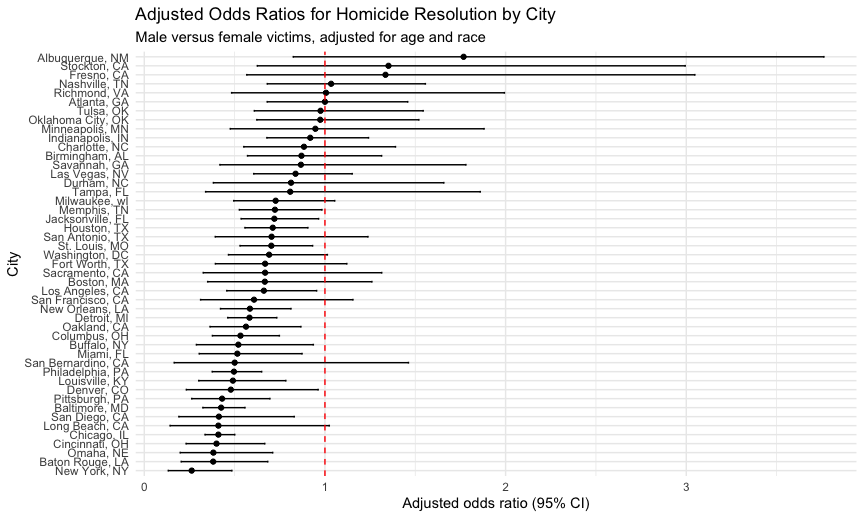

p8105_hw6_hyw2105.Rmd
================
Irene Wen
2026-11-24

# Problem 1: Logistic Regression for Homicide Resolution

## Data Import and Cleaning

``` r
homicide_raw =
  read_csv(
    "data/homicide-data.csv",
    na = c("", "NA", "Unknown")
  )
```

    ## Rows: 52179 Columns: 12
    ## ── Column specification ────────────────────────────────────────────────────────
    ## Delimiter: ","
    ## chr (8): uid, victim_last, victim_first, victim_race, victim_sex, city, stat...
    ## dbl (4): reported_date, victim_age, lat, lon
    ## 
    ## ℹ Use `spec()` to retrieve the full column specification for this data.
    ## ℹ Specify the column types or set `show_col_types = FALSE` to quiet this message.

``` r
homicide_df =
  homicide_raw |>
  mutate(
    city_state = str_c(city, state, sep = ", "),
    resolved = as.numeric(disposition == "Closed by arrest"),
    victim_age = as.numeric(victim_age)
  ) |>
  filter(
    !city_state %in% c(
      "Dallas, TX",
      "Phoenix, AZ",
      "Kansas City, MO",
      "Tulsa, AL"
    ),
    victim_race %in% c("White", "Black"),
    victim_sex %in% c("Female", "Male")
  ) |>
  mutate(
    victim_race = fct_relevel(victim_race, "White"),
    victim_sex = fct_relevel(victim_sex, "Female")
  ) |>
  select(
    city_state, resolved, victim_age,
    victim_race, victim_sex
  ) |>
  drop_na()
```

``` r
homicide_df |>
  summarize(
    n_observations = n(),
    n_cities = n_distinct(city_state),
    n_missing_age = sum(is.na(victim_age))
  ) |>
  knitr::kable()
```

| n_observations | n_cities | n_missing_age |
|---------------:|---------:|--------------:|
|          39362 |       47 |             0 |

``` r
homicide_df |>
  count(victim_race, victim_sex) |>
  knitr::kable()
```

| victim_race | victim_sex |     n |
|:------------|:-----------|------:|
| White       | Female     |  1818 |
| White       | Male       |  4453 |
| Black       | Female     |  4012 |
| Black       | Male       | 29079 |

``` r
homicide_df |>
  count(resolved) |>
  mutate(proportion = n / sum(n)) |>
  knitr::kable(digits = 3)
```

| resolved |     n | proportion |
|---------:|------:|-----------:|
|        0 | 20155 |      0.512 |
|        1 | 19207 |      0.488 |

The homicide data were obtained from The Washington Post’s public GitHub
repository. I created a city-state identifier and a binary outcome
indicating whether a homicide was resolved by arrest. Dallas, TX;
Phoenix, AZ; Kansas City, MO; and Tulsa, AL were excluded as specified
in the assignment. The analysis was restricted to Black and White
victims with known sex and complete model covariates. Victim age was
converted to a numeric variable, and female and White victims were
selected as the reference categories.

After data cleaning, the final analytical dataset consisted of 39,362
homicide records across 47 cities, with no missing values for victim
age. Of these cases, 19,207 (48.8%) were resolved by arrest, while
20,155 (51.2%) were not. The majority of records involved Black male
victims, accounting for 73.9% of the analytical sample.

## Logistic Regression for Baltimore

``` r
baltimore_df =
  homicide_df |>
  filter(city_state == "Baltimore, MD")

baltimore_fit =
  baltimore_df |>
  glm(
    resolved ~ victim_age + victim_sex + victim_race,
    data = _,
    family = binomial()
  )
```

``` r
baltimore_or =
  baltimore_fit |>
  broom::tidy(
    conf.int = TRUE,
    exponentiate = TRUE
  ) |>
  filter(term == "victim_sexMale") |>
  select(
    term,
    OR = estimate,
    conf.low,
    conf.high
  )

baltimore_or |>
  knitr::kable(
    digits = 3,
    col.names = c(
      "Predictor",
      "Adjusted OR",
      "95% CI Lower",
      "95% CI Upper"
    )
  )
```

| Predictor      | Adjusted OR | 95% CI Lower | 95% CI Upper |
|:---------------|------------:|-------------:|-------------:|
| victim_sexMale |       0.426 |        0.324 |        0.558 |

I fitted a multivariable logistic regression model for Baltimore, MD,
with homicide resolution as the outcome and victim age, sex, and race as
predictors. After adjusting for victim age and race, homicides involving
male victims had approximately 57.4% lower odds of being resolved by
arrest than those involving female victims (adjusted OR = 0.426, 95% CI:
0.324–0.558). The confidence interval did not include 1, indicating a
statistically significant association between victim sex and homicide
resolution in Baltimore.

## Logistic Regression Across Cities

``` r
city_models =
  homicide_df |>
  nest(datasets = -city_state) |>
  mutate(
    fits = map(
      datasets,
      \(df) glm(
        resolved ~ victim_age + victim_sex + victim_race,
        data = df,
        family = binomial()
      )
    ),
    results = map(
      fits,
      \(fit) broom::tidy(
        fit,
        conf.int = TRUE,
        exponentiate = TRUE
      )
    )
  )
```

``` r
city_or_df =
  city_models |>
  select(city_state, results) |>
  unnest(results) |>
  filter(term == "victim_sexMale") |>
  select(
    city_state,
    OR = estimate,
    conf.low,
    conf.high
  ) |>
  arrange(OR)

city_or_df
```

    ## # A tibble: 47 × 4
    ##    city_state         OR conf.low conf.high
    ##    <chr>           <dbl>    <dbl>     <dbl>
    ##  1 New York, NY    0.262    0.133     0.485
    ##  2 Baton Rouge, LA 0.381    0.204     0.684
    ##  3 Omaha, NE       0.382    0.199     0.711
    ##  4 Cincinnati, OH  0.400    0.231     0.667
    ##  5 Chicago, IL     0.410    0.336     0.501
    ##  6 Long Beach, CA  0.410    0.143     1.02 
    ##  7 San Diego, CA   0.413    0.191     0.830
    ##  8 Baltimore, MD   0.426    0.324     0.558
    ##  9 Pittsburgh, PA  0.431    0.263     0.696
    ## 10 Denver, CO      0.479    0.233     0.962
    ## # ℹ 37 more rows

I fitted separate logistic regression models for all 47 cities using
nested data frames and the `map()` function. Each model included victim
age, sex, and race as predictors, with female and White victims serving
as the reference categories. The model coefficients and confidence
limits were exponentiated to obtain city-specific adjusted odds ratios
and 95% confidence intervals comparing male victims with female victims.
The results were then combined into a single tidy data frame and ordered
by the estimated odds ratios.

As a consistency check, the Baltimore estimate obtained from the
city-specific analysis matched the result from the individual logistic
regression model (adjusted OR = 0.426, 95% CI: 0.324–0.558), confirming
that the iterative modeling workflow reproduced the Baltimore result.

## Comparison of City-Specific Odds Ratios

``` r
city_or_df |>
  mutate(
    city_state = fct_reorder(city_state, OR)
  ) |>
  ggplot(aes(x = city_state, y = OR)) +
  geom_point() +
  geom_errorbar(
    aes(ymin = conf.low, ymax = conf.high),
    width = 0.2
  ) +
  geom_hline(
    yintercept = 1,
    linetype = "dashed",
    color = "red"
  ) +
  coord_flip() +
  labs(
    title = "Adjusted Odds Ratios for Homicide Resolution by City",
    subtitle = "Male versus female victims, adjusted for age and race",
    x = "City",
    y = "Adjusted odds ratio (95% CI)"
  )
```



``` r
theme(
  axis.text.y = element_text(size = 9),
  panel.grid.minor = element_blank()
)
```

    ## <theme> List of 2
    ##  $ axis.text.y     : <ggplot2::element_text>
    ##   ..@ family       : NULL
    ##   ..@ face         : NULL
    ##   ..@ italic       : chr NA
    ##   ..@ fontweight   : num NA
    ##   ..@ fontwidth    : num NA
    ##   ..@ colour       : NULL
    ##   ..@ size         : num 9
    ##   ..@ hjust        : NULL
    ##   ..@ vjust        : NULL
    ##   ..@ angle        : NULL
    ##   ..@ lineheight   : NULL
    ##   ..@ margin       : NULL
    ##   ..@ debug        : NULL
    ##   ..@ inherit.blank: logi FALSE
    ##  $ panel.grid.minor: <ggplot2::element_blank>
    ##  @ complete: logi FALSE
    ##  @ validate: logi TRUE

``` r
city_or_df |>
  summarize(
    n_cities = n(),
    n_or_below_one = sum(OR < 1),
    n_ci_below_one = sum(conf.high < 1),
    n_ci_above_one = sum(conf.low > 1),
    n_ci_includes_one = sum(
      conf.low <= 1 & conf.high >= 1
    )
  ) |>
  knitr::kable()
```

| n_cities | n_or_below_one | n_ci_below_one | n_ci_above_one | n_ci_includes_one |
|---------:|---------------:|---------------:|---------------:|------------------:|
|       47 |             41 |             22 |              0 |                25 |

Across the 47 cities included in the analysis, 41 (87.2%) had adjusted
odds ratios below 1, suggesting that homicides involving male victims
generally had lower odds of being resolved by arrest than those
involving female victims after adjustment for victim age and race.

The magnitude and precision of the estimated associations varied
considerably across cities. The adjusted odds ratios ranged from 0.262
in New York, NY (95% CI: 0.133–0.485), to 1.767 in Albuquerque, NM (95%
CI: 0.825–3.762). Of the 47 cities, 22 had 95% confidence intervals
entirely below 1, while the remaining 25 had confidence intervals that
included 1. No city had a confidence interval entirely above 1.

Overall, the results suggest a broadly consistent pattern of lower odds
of homicide resolution for male victims, although the strength and
statistical precision of this association varied across cities.

# Problem 2: Bootstrap Inference for Weather Data

## Data Preparation

## Linear Regression Model

## Bootstrap Sampling and Model Fitting

## Bootstrap Distributions

## Bootstrap Confidence Intervals

# Problem 3: Birthweight Regression and Cross Validation

## Data Import and Cleaning

## Proposed Regression Model

## Residual Diagnostics

## Alternative Regression Models

## Monte Carlo Cross Validation

## Comparison of Prediction Error
